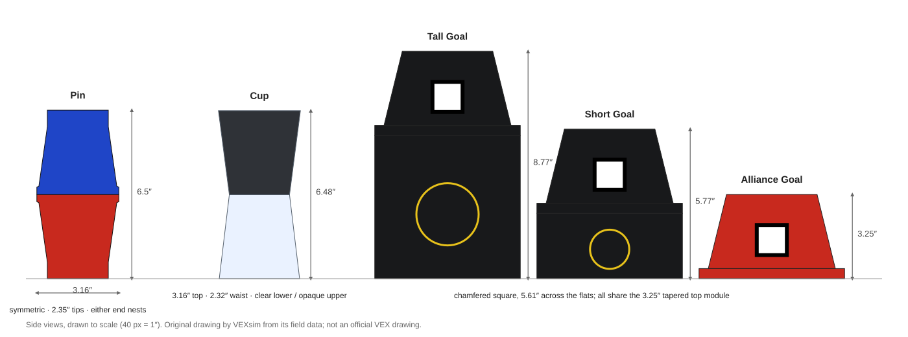

# Override field spec (VEXsim)

> Generated from the simulator's field data by `npm run reference`. Don't edit by hand. Each value names its source; **assumption** marks values VEXsim had to choose. The official game manual always wins.

## Coordinates
Origin at the field center. **+x** points toward the blue Alliance Station (East wall); red stands on the West wall. **+z** points toward the South wall. Diagrams put North at the top. Values are in inches, with meters in `field-spec.json`.

## Field
- 140.41″ square inside the walls (Appendix A), 36 foam tiles (6 × 6)
- Perimeter: 11.54″ tall, 2″ thick (portable perimeter; the metal perimeter is 140.50 in inside, 11.50 in tall, 1.27 in thick)
- Goals and starting elements sit on a grid 23.55″ and 47.1″ from the center
- Tape: Midfield diamond, corners 23.55 in from the center on the axes; Autonomous Line corner to corner through the Midfield diamond, from about 58.5 in out on each axis; doubled on the North-West to South-East diagonal; Load Zones: alliance-colored L in each corner on the station walls, about 11 in from the station wall and 23.4 in along it
- Counts: 63 Pins (20 red/yellow, 20 blue/yellow, 19 yellow/yellow, 4 red/blue), 56 Cups, 9 Goals, 4 Toggles, 4 Loaders *(game manual)*

## Goals
| Goal | Kind | Quadrant | x″ | z″ | Height″ |
| --- | --- | --- | --- | --- | --- |
| center | tall | Midfield | 0 | 0 | 8.77 |
| N-short | short | N | -23.55 | -47.1 | 5.77 |
| N-blue | alliance (blue) | N | 23.55 | -47.1 | 3.25 |
| E-blue | alliance (blue) | E | 47.1 | -23.55 | 3.25 |
| E-short | short | E | 47.1 | 23.55 | 5.77 |
| S-short | short | S | 23.55 | 47.1 | 5.77 |
| S-red | alliance (red) | S | -23.55 | 47.1 | 3.25 |
| W-red | alliance (red) | W | -47.1 | 23.55 | 3.25 |
| W-short | short | W | -47.1 | -23.55 | 5.77 |

Chamfered-square footprint, 5.61″ across the flats, tapering to 3.49″ at the top.

## Toggles
| Quadrant | x″ | z″ | Axis height″ | Starts |
| --- | --- | --- | --- | --- |
| N | 0 | -71.21 | 13.2 | yellow up and into the field, blue facing out |
| E | 71.21 | 0 | 13.2 | yellow up and into the field, blue facing out |
| S | 0 | 71.21 | 13.2 | yellow up and into the field, red facing out |
| W | -71.21 | 0 | 13.2 | yellow up and into the field, red facing out |

25.8″ long triangular prisms with 2.05″ faces (yellow, red, blue), on top of the perimeter, at the middle of the wall. A Toggle counts only when set to a color and not touched by any Robot. 

## Loaders
| Alliance | x″ | z″ |
| --- | --- | --- |
| red | -68.01 | -58.77 |
| red | -68.01 | 58.77 |
| blue | 68.01 | -58.77 |
| blue | 68.01 | 58.77 |

Each hangs on the inside of the alliance wall: a 22.97″ clear chute, 4.02″ wide, on a 11.85″ mount.

## Game elements

- **Pin:** 6.5″ long, hexagonal and symmetric (3.16″ across the collar's corners, 3.02″ across the flats). Each end is a 2.35″ tip, so either end nests into a Goal or Cup. Each half scores separately.
- **Cup:** 6.48″ tall, 3.16″ across the top, 2.32″ at the waist; clear lower half, opaque upper half. A Pin half inside the opaque half doesn't score.
- **Goals:** chamfered square, 5.61 in across the flats, 3.22 in center to corner; every Goal is topped by the same 3.25 in tapered module: 0.39 in flange, tapering to 3.49 in across, 2.37 in hole, code marker 1.49 in up. neutral Goals black with yellow line art; Alliance Goals red or blue.
- **Stacking:** the Pin’s 0.64 in tip drops into the Goal hole; a Cup’s clear lower half slides over the Pin and rests on its center collar; the next Pin’s tip sits at the Cup’s waist, inside its opaque upper half (that half is hidden, SC3).

## Match Loads and Preloads
- **Match:** 10 Cups + 10 alliance/yellow Pins + 1 yellow/yellow Pin per alliance *(game manual field definition; the order they come out is an assumption)*
- **Skills:** 3 red/yellow Pins, 4 blue/yellow Pins and 7 Cups begin off the field as Match Loads; the neutral Goals start empty *(game manual (Robot Skills), Figure RSC4-1)*
- **Preload:** 1 alliance/yellow Pin (2 per alliance) per robot

## Starting layout
Head-to-Head Match layout from the Scoring Object Locations sheet. Pin colors: standing [down, up]; lying [outer end, inner end]. Which Cups start clear side up is an assumption. *(Appendix A: scoring object locations)*

| Element | Colors / side | Pose | x″ | z″ |
| --- | --- | --- | --- | --- |
| Pin | yellow / yellow | goal | 0 | 0 |
| Pin | yellow / yellow | goal | -23.55 | -47.1 |
| Pin | yellow / yellow | goal | 47.1 | 23.55 |
| Pin | yellow / yellow | goal | 23.55 | 47.1 |
| Pin | yellow / yellow | goal | -47.1 | -23.55 |
| Pin | blue / yellow | lying | -47.1 | -52.13 |
| Pin | blue / yellow | lying | -42.07 | -47.1 |
| Pin | red / yellow | lying | -52.13 | -47.1 |
| Pin | red / yellow | lying | -47.1 | -42.07 |
| Pin | blue / yellow | lying | -23.55 | -28.58 |
| Pin | blue / yellow | lying | -18.52 | -23.55 |
| Pin | red / yellow | lying | -28.58 | -23.55 |
| Pin | red / yellow | lying | -23.55 | -18.52 |
| Pin | blue / yellow | lying | 23.55 | 18.52 |
| Pin | blue / yellow | lying | 28.58 | 23.55 |
| Pin | red / yellow | lying | 18.52 | 23.55 |
| Pin | red / yellow | lying | 23.55 | 28.58 |
| Pin | blue / yellow | lying | 47.1 | 42.07 |
| Pin | blue / yellow | lying | 52.13 | 47.1 |
| Pin | red / yellow | lying | 42.07 | 47.1 |
| Pin | red / yellow | lying | 47.1 | 52.13 |
| Pin | yellow / yellow | inCup | -47.1 | 47.1 |
| Pin | yellow / yellow | inCup | -23.55 | 23.55 |
| Pin | yellow / yellow | inCup | 23.55 | -23.55 |
| Pin | yellow / yellow | inCup | 47.1 | -47.1 |
| Pin | red / blue | inCup | 0 | -23.55 |
| Pin | red / blue | inCup | 23.55 | 0 |
| Pin | blue / red | inCup | -23.55 | 0 |
| Pin | blue / red | inCup | 0 | 23.55 |
| Pin | yellow / yellow | inCup | -23.55 | -68.62 |
| Pin | yellow / yellow | inCup | 23.55 | -68.62 |
| Pin | yellow / yellow | inCup | 68.63 | -23.55 |
| Pin | yellow / yellow | inCup | 68.63 | 23.55 |
| Pin | yellow / yellow | inCup | -23.55 | 68.63 |
| Pin | yellow / yellow | inCup | 23.55 | 68.63 |
| Pin | yellow / yellow | inCup | -68.62 | -23.55 |
| Pin | yellow / yellow | inCup | -68.62 | 23.55 |
| Cup | clear up | standing | -47.1 | -47.1 |
| Cup | clear up | standing | -23.55 | -23.55 |
| Cup | clear up | standing | 23.55 | 23.55 |
| Cup | clear up | standing | 47.1 | 47.1 |
| Cup | clear up | standing | -47.1 | 47.1 |
| Cup | clear up | standing | -23.55 | 23.55 |
| Cup | clear up | standing | 23.55 | -23.55 |
| Cup | clear up | standing | 47.1 | -47.1 |
| Cup | clear up | standing | 0 | -23.55 |
| Cup | clear up | standing | 23.55 | 0 |
| Cup | clear up | standing | -23.55 | 0 |
| Cup | clear up | standing | 0 | 23.55 |
| Cup | gray up | standing | -26.71 | -68.62 |
| Cup | gray up | standing | -23.55 | -68.62 |
| Cup | gray up | standing | -20.39 | -68.62 |
| Cup | gray up | standing | 20.39 | -68.62 |
| Cup | gray up | standing | 23.55 | -68.62 |
| Cup | gray up | standing | 26.71 | -68.62 |
| Cup | gray up | standing | 68.63 | -26.71 |
| Cup | gray up | standing | 68.63 | -23.55 |
| Cup | gray up | standing | 68.63 | -20.39 |
| Cup | gray up | standing | 68.63 | 20.39 |
| Cup | gray up | standing | 68.63 | 23.55 |
| Cup | gray up | standing | 68.63 | 26.71 |
| Cup | gray up | standing | -26.71 | 68.63 |
| Cup | gray up | standing | -23.55 | 68.63 |
| Cup | gray up | standing | -20.39 | 68.63 |
| Cup | gray up | standing | 20.39 | 68.63 |
| Cup | gray up | standing | 23.55 | 68.63 |
| Cup | gray up | standing | 26.71 | 68.63 |
| Cup | gray up | standing | -68.62 | -26.71 |
| Cup | gray up | standing | -68.62 | -23.55 |
| Cup | gray up | standing | -68.62 | -20.39 |
| Cup | gray up | standing | -68.62 | 20.39 |
| Cup | gray up | standing | -68.62 | 23.55 |
| Cup | gray up | standing | -68.62 | 26.71 |
