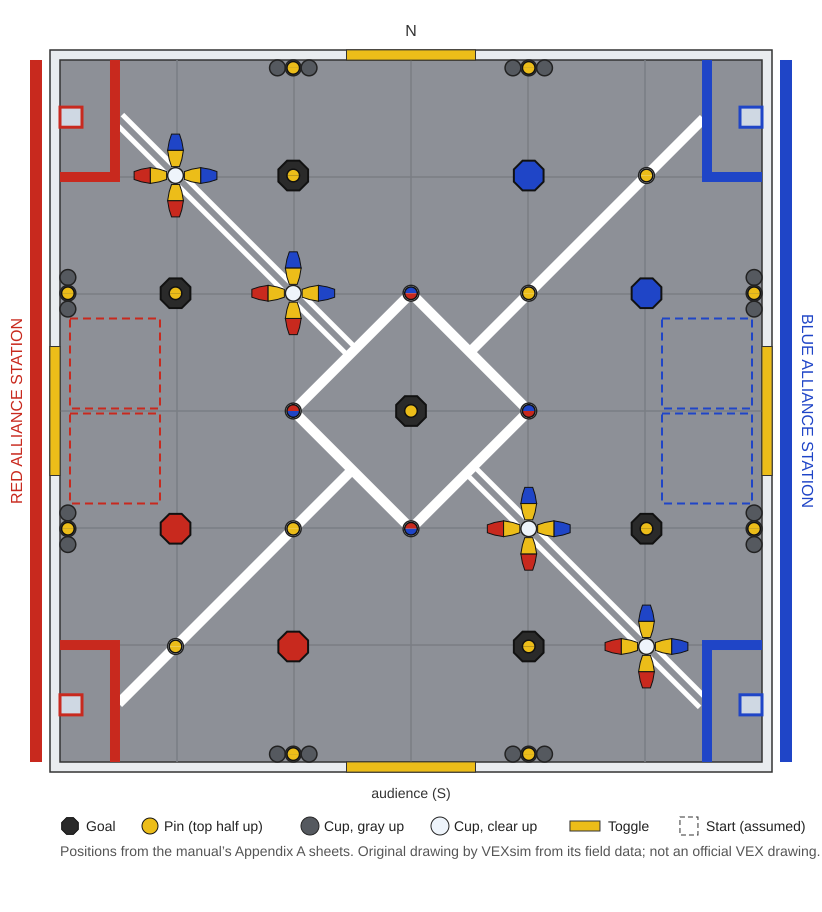

# Override field spec (VEXsim)

> Generated from the simulator's field data by `npm run reference`. Don't edit by hand. Each value names its source; **assumption** marks values VEXsim had to choose. The official game manual always wins.

## Coordinates
Origin at the field center. **+x** points toward the blue Alliance Station (East wall); red stands on the West wall. **+z** points toward the South wall. Diagrams put North at the top. Values are in inches, with meters in `field-spec.json`.

## Field
- 12 ft × 12 ft, made of 36 foam tiles (6 × 6, 24″ each)
- Tape: two corner-to-corner diagonals make the four Quadrants (N, E, S, W); the Midfield is a 48″ diamond with a center cross
- Counts: 63 Pins (20 red/yellow, 20 blue/yellow, 19 yellow/yellow, 4 red/blue), 56 Cups, 9 Goals, 4 Toggles, 4 Loaders *(game manual)*

## Goals
| Goal | Kind | Quadrant | x″ | z″ | Height″ |
| --- | --- | --- | --- | --- | --- |
| center | tall | Midfield | 0 | 0 | 8.8 |
| N-short | short | N | -23.6 | -47.2 | 5.8 |
| N-blue | alliance (blue) | N | 23.6 | -47.2 | 3.2 |
| E-blue | alliance (blue) | E | 47.2 | -23.6 | 3.2 |
| E-short | short | E | 47.2 | 23.6 | 5.8 |
| S-short | short | S | 23.6 | 47.2 | 5.8 |
| S-red | alliance (red) | S | -23.6 | 47.2 | 3.2 |
| W-red | alliance (red) | W | -47.2 | 23.6 | 3.2 |
| W-short | short | W | -47.2 | -23.6 | 5.8 |

Octagonal and tapered, 6.1″ across at the base and 3.8″ at the top.

## Toggles
| Quadrant | x″ | z″ | Length″ |
| --- | --- | --- | --- |
| N | 0 | -70.1 | 25.8 |
| E | 70.1 | 0 | 25.8 |
| S | 0 | 70.1 | 25.8 |
| W | -70.1 | 0 | 25.8 |

Three faces (yellow neutral, red, blue). A Toggle counts only when set to a color and not touched by any Robot. 

## Loaders
| Alliance | x″ | z″ |
| --- | --- | --- |
| red | -68.5 | -58.7 |
| red | -68.5 | 58.7 |
| blue | 68.5 | -58.7 |
| blue | 68.5 | 58.7 |

## Game elements

- **Pin:** 6.5″ long and hexagonal (3.7″ across corners). One half tapers to 1.7″ and nests into a Goal or Cup. Each half scores separately.
- **Cup:** 6.5″ tall hourglass with a clear lower half and an opaque upper half. A Pin half inside the opaque half doesn't score.

## Match Loads and Preloads
- **Match:** 10 Cups + 10 alliance-color Pins + 1 yellow/yellow Pin per alliance *(game manual summary; order of release is an assumption)*
- **Skills:** 3 red/yellow Pins, 4 blue/yellow Pins and 7 Cups begin off the field as Match Loads *(game manual (Skills), as quoted)*
- **Preload:** 1 alliance-color Pin per robot

## Starting layout
20 elements come from the official VEXcode VR layout. The rest (36 Pins and 36 Cups on the field in total, plus 1 yellow Pin on the Tall Goal) are **filled in symmetrically by VEXsim (assumption)**. Replace them in `startingLayout()` in `src/games/override/game.ts` once checked against the manual, then run `npm run reference`.

| Element | Colors (tapered / flat) | x″ | z″ | Source |
| --- | --- | --- | --- | --- |
| Pin | red / yellow | -23.6 | -68.7 | official |
| Pin | blue / yellow | 23.6 | 68.7 | official |
| Pin | red / yellow | -68.7 | -23.6 | official |
| Pin | blue / yellow | 68.7 | 23.6 | official |
| Pin | blue / yellow | 23.6 | -68.7 | official |
| Pin | red / yellow | -23.6 | 68.7 | official |
| Pin | blue / yellow | 68.7 | -23.6 | official |
| Pin | red / yellow | -68.7 | 23.6 | official |
| Pin | yellow / yellow | 0 | -23.6 | official |
| Pin | yellow / yellow | 0 | 23.6 | official |
| Pin | red / blue | -23.6 | 0 | official |
| Pin | blue / red | 23.6 | 0 | official |
| Pin | red / yellow | -35.4 | -35.4 | filled |
| Pin | blue / yellow | 35.4 | 35.4 | filled |
| Pin | red / yellow | -23.6 | -11.8 | filled |
| Pin | blue / yellow | 23.6 | 11.8 | filled |
| Pin | blue / yellow | -35.4 | -47.2 | filled |
| Pin | red / yellow | 35.4 | 47.2 | filled |
| Pin | blue / yellow | -11.8 | 23.6 | filled |
| Pin | red / yellow | 11.8 | -23.6 | filled |
| Pin | yellow / yellow | -35.4 | -23.6 | filled |
| Pin | yellow / yellow | 35.4 | 23.6 | filled |
| Pin | yellow / yellow | -11.8 | -47.2 | filled |
| Pin | yellow / yellow | 11.8 | 47.2 | filled |
| Pin | yellow / yellow | -23.6 | 35.4 | filled |
| Pin | yellow / yellow | 23.6 | -35.4 | filled |
| Pin | yellow / yellow | -47.2 | -59.1 | filled |
| Pin | yellow / yellow | 47.2 | 59.1 | filled |
| Pin | yellow / yellow | -47.2 | 59.1 | filled |
| Pin | yellow / yellow | 47.2 | -59.1 | filled |
| Pin | yellow / yellow | -11.8 | -23.6 | filled |
| Pin | yellow / yellow | 11.8 | 23.6 | filled |
| Pin | yellow / yellow | -11.8 | -11.8 | filled |
| Pin | yellow / yellow | 11.8 | 11.8 | filled |
| Pin | red / blue | 0 | -35.4 | filled |
| Pin | blue / red | 0 | 35.4 | filled |
| Cup | — | -47.2 | -47.2 | official |
| Cup | — | 47.2 | 47.2 | official |
| Cup | — | 47.2 | -47.2 | official |
| Cup | — | -47.2 | 47.2 | official |
| Cup | — | -23.6 | -23.6 | official |
| Cup | — | 23.6 | 23.6 | official |
| Cup | — | 23.6 | -23.6 | official |
| Cup | — | -23.6 | 23.6 | official |
| Cup | — | -47.2 | 11.8 | filled |
| Cup | — | 47.2 | -11.8 | filled |
| Cup | — | -35.4 | 11.8 | filled |
| Cup | — | 35.4 | -11.8 | filled |
| Cup | — | -59.1 | -23.6 | filled |
| Cup | — | 59.1 | 23.6 | filled |
| Cup | — | -23.6 | 59.1 | filled |
| Cup | — | 23.6 | -59.1 | filled |
| Cup | — | -35.4 | 59.1 | filled |
| Cup | — | 35.4 | -59.1 | filled |
| Cup | — | -11.8 | 47.2 | filled |
| Cup | — | 11.8 | -47.2 | filled |
| Cup | — | -35.4 | 0 | filled |
| Cup | — | 35.4 | 0 | filled |
| Cup | — | -47.2 | -11.8 | filled |
| Cup | — | 47.2 | 11.8 | filled |
| Cup | — | -11.8 | -35.4 | filled |
| Cup | — | 11.8 | 35.4 | filled |
| Cup | — | -47.2 | 0 | filled |
| Cup | — | 47.2 | 0 | filled |
| Cup | — | -35.4 | 35.4 | filled |
| Cup | — | 35.4 | -35.4 | filled |
| Cup | — | -35.4 | 23.6 | filled |
| Cup | — | 35.4 | -23.6 | filled |
| Cup | — | -11.8 | 0 | filled |
| Cup | — | 11.8 | 0 | filled |
| Cup | — | 0 | -47.2 | filled |
| Cup | — | 0 | 47.2 | filled |
